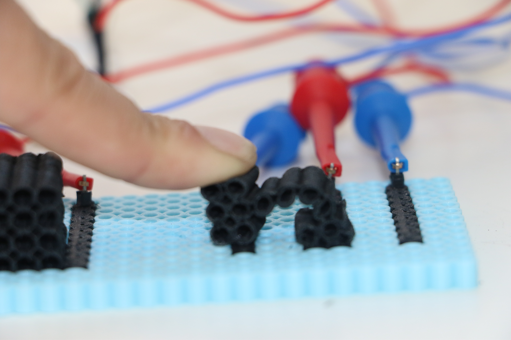

# Beadle


**Beadle** is an open-source computer-aided design (CAD) toolkit for designing modular fuse bead artwork and generating fabrication-ready 3D models. The software enables makers, educators, researchers, and designers to rapidly prototype fuse bead assemblies through an interactive browser-based interface with STL export for additive manufacturing.

Developed by [**The Hybrid Atelier**](https://hybridatelier.uta.edu/) in the Department of Computer Science and Engineering at **The University of Texas at Arlington**, Beadle accompanies our research on computational fabrication, digital craft, and creativity support tools.
> **Repository name:** `perler-sim` (legacy repository name retained for compatibility).

---

## Authors

* [Mariah Gardner](https://hybridatelier.uta.edu/members/180-mariah-gardner)
* [Nasir Rakib](https://hybridatelier.uta.edu/members/128-nasir-rakib)
* [Cesar Torres](https://hybridatelier.uta.edu/members/1-cesar-torres)

---

## Features

* Interactive editor for creating fuse bead designs
* Parametric modeling of bead assemblies
* Real-time visual editing
* STL export for 3D printing
* Browser-based interface built with React

---

## Prerequisites

* [Node.js](https://nodejs.org/) 18+
* [OpenSCAD](https://openscad.org/downloads.html) — required locally for STL export (`openscad` must be on your `PATH`)

---

## Installation

```bash
git clone https://github.com/The-Hybrid-Atelier/perler-sim.git
cd perler-sim
make setup        # npm install + creates .env from .env.example
```

Edit `.env` if you want to enable optional features (see [Configuration](#configuration)).

---

## Running

```bash
make dev          # client + server together (recommended)
make client-dev   # React dev server only  (port 3000)
make server-dev   # Express server only    (port 3001)
```

The app will be available at `http://localhost:3000`.

---

## Configuration

Copy `.env.example` to `.env` (`make setup` does this automatically). Key flags:

| Variable | Default | Description |
|---|---|---|
| `REQUIRE_AUTH` | `false` | Set `true` to require GitHub login before the editor loads |
| `ENABLE_DB` | `false` | Set `true` to enable Neo4j usage tracking |
| `GITHUB_CLIENT_ID` / `GITHUB_CLIENT_SECRET` | — | Required when auth is enabled |
| `NEO4J_URI` / `NEO4J_USER` / `NEO4J_PASSWORD` | — | Required when `ENABLE_DB=true` |

By default, users go straight to the editor with no login required.

---

## Building

```bash
npm run build           # production React bundle → build/
make docker-build       # Docker image tagged with git SHA
make docker-run         # run image locally, loading .env
```

---

## Usage

1. Launch the application.
2. Create or edit a fuse bead design using the interactive editor.
3. Inspect the generated geometry.
4. Export the design as an STL file.
5. Slice the model using your preferred slicer.
6. Fabricate using a compatible 3D printer.

---

## Research

Beadle was developed as part of ongoing research into computational fabrication, digital craft, and creativity support technologies.

If you use Beadle in academic work, please cite the accompanying publication.

```bibtex
% Citation forthcoming — publication in preparation.
```

---

## Contributing

We welcome contributions of community-made designs! You can either submit a pull request via Github or send us a link to your Instructables, Thingiverse, or design files to hybrid.atelier.uta@gmail.com

If you encounter a bug, discover an issue, or have a feature request, please open a GitHub Issue. Pull requests are also appreciated.

Before submitting a pull request, please ensure that:

* New functionality is documented.
* Existing functionality continues to work as expected.
* Code follows the project's existing style.

---

## Development

Built with React 18, Express, Paper.js, and OpenSCAD (via shell exec for STL generation).

```bash
make setup        # first-time install
make dev          # run everything
npm test          # React test suite
```

---

## License

This project is released under the MIT License. See the `LICENSE` file for details.

---

## Acknowledgments

Beadle was developed within **The Hybrid Atelier** at **The University of Texas at Arlington**. This work was supported by the i-Engage program, the National Science Foundation under Grant No. CNS-2150321, and a Microsoft Research Accelerating Foundational Models Grant.
